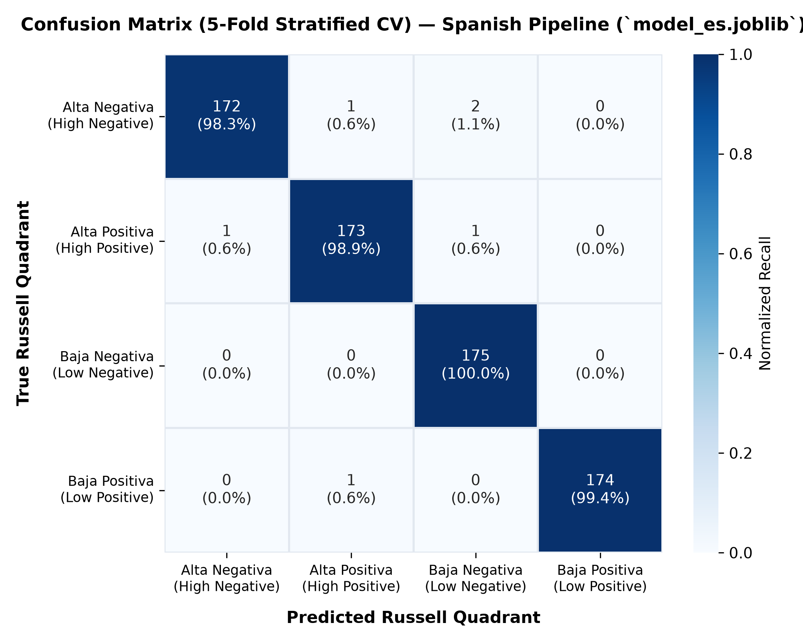
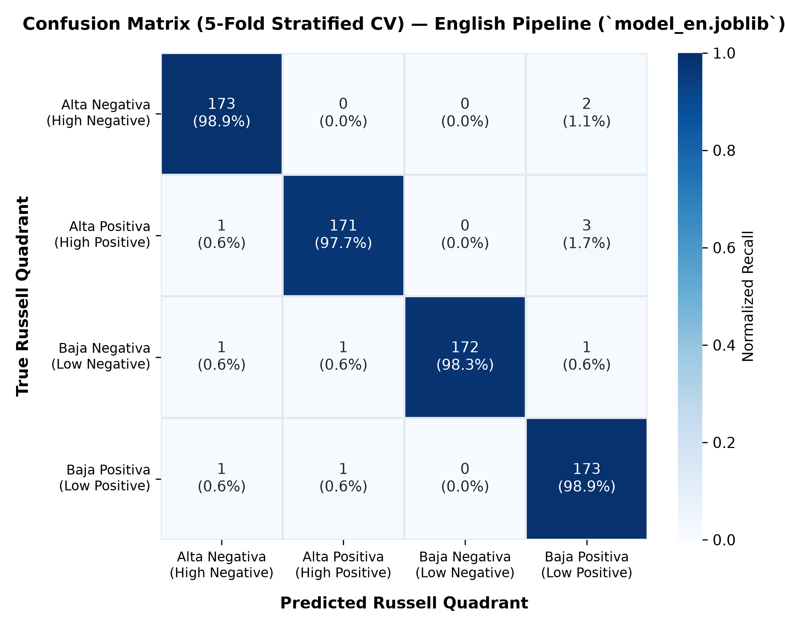

<p align="center">
  
</p>

# Emotion Finder — Interactive Emotion Detector
> **Bilingual Affective NLP Classifier & Somatic Decision Tree based on Russell's Circumplex Model of Affect**

[English](README.md) | [Español](README.es.md)

[](https://www.python.org/)
[](https://docs.fastht.ml/)
[](https://htmx.org/)
[](https://picocss.com/)
[](https://scikit-learn.org/)
[](#)
[](https://turso.tech/)
[](https://github.com/AnaCataVC/emotion-finder/actions)
[](https://vercel.com/)
[](https://github.com/AnaCataVC/emotion-finder)
[](https://opensource.org/licenses/MIT)

---

## Project Overview

**Emotion Finder** is an interactive, bilingual (Spanish/English) web application engineered to bridge the gap between vague somatic/mental sensations and emotional self-awareness.

Instead of forcing users to guess abstract psychiatric labels from an overwhelming drop-down list, Emotion Finder employs a multi-stage **hybrid architecture**:
1. **Affective NLP Classifier**: Maps freeform natural language descriptions of physical and cognitive sensations into one of the 4 quadrants of **Russell's Circumplex Model of Affect** (Activation/Arousal $\times$ Valence).
2. **Semantic Emotion Matcher**: Ranks the quadrant's 16 emotions by TF-IDF cosine similarity between the user's words and each emotion's clinical definition, jumping straight to a confident match when clear.
3. **Binary Somatic Decision Tree (Fallback)**: When no direct match is confident enough, guides the user through an interactive 4-step sequence of body-focused Yes/No questions to pinpoint **1 of 64 precise emotions** (16 per quadrant) with $100\%$ topological determinism.
4. **Serverless Active Learning Loop (HITL)**: Captures user validations and corrections under strict anti-poisoning defenses (network-anchored rate limiting, hybrid status promotion, 10% volume cap, weekly CI/CD retraining).

---

## How It Works

```
  1. Freeform Input ("siento el pecho apretado y me hierve la sangre")
                             │
                             ▼
  2. Language Routing & Sentiment-Safe Preprocessing (Snowball/Porter + Custom Whitelist)
                             │
                             ▼
  3. TF-IDF + Logistic Regression (27 KB · 0.8 ms inference · Vercel Serverless)
                             │
                             ▼
  4. Affective Quadrant Prediction (e.g. Alta Activación · Negativa)
                             │
         ┌───────────────────┴───────────────────┐
         ▼                                       ▼
  [Direct Semantic Match]                 [Weak Match / Ambiguous]
  Cosine similarity >= 0.35                      │
         │                                       ▼
         │                        [Plain-Language Quadrant Confirmation]
         │                        ("Does this feel right?" — No pivots to runner-up)
         │                                       │
         │                                       ▼
         │                        [4-Step Somatic Decision Tree]
         │                        (Body Tension -> Heart Rate -> Focus -> Action)
         │                                       │
         └───────────────────┬───────────────────┘
                             ▼
  5. Empathetic Leaf Card (Identified Emotion + Definition + Feedback Form)
                             │
                             ▼
  6. Hybrid HITL Feedback Store (Local SQLite / Turso LibSQL Pipeline / NullStore)
```

---

## ML Evaluation & Empirical Benchmarks

To establish rigorous experimental evidence rather than relying solely on in-distribution metrics, candidate models were benchmarked across 5-Fold Stratified Cross-Validation on $N=700$ balanced samples per language, along with a dual-probe out-of-distribution evaluation:

### Benchmark Summary Across Candidate Architectures

| Architecture | CV Macro $F_1$ (ES) | CV Macro $F_1$ (EN) | Known Idioms Pass Rate | Held-Out Generalization | Model Size | Cold Load | Warm Infer | Calibrated Probabilities |
| :--- | :---: | :---: | :---: | :---: | :---: | :---: | :---: | :---: |
| **Dummy (Stratified)** | $0.227$ | $0.227$ | $14\%\text{--}40\%$ | $20\%\text{--}28\%$ | $7.6\text{ KB}$ | $2.0\text{ ms}$ | $0.94\text{ ms}$ | No |
| **Multinomial NB** | $0.987$ | $0.979$ | $100\%$ | $28\%\text{--}40\%$ | $21.0\text{ KB}$ | $4.5\text{ ms}$ | $0.73\text{ ms}$ | Raw Dirichlet |
| **Linear SVM** | $\mathbf{0.996}$ | $\mathbf{0.987}$ | $100\%$ | $\mathbf{40\%\text{--}43\%}$ | $26.8\text{ KB}$ | $4.8\text{ ms}$ | $0.77\text{ ms}$ | No (Hinge loss) |
| **Random Forest** | $0.870$ | $0.860$ | $57\%\text{--}60\%$ | $28\%\text{--}40\%$ | $91.4\text{ KB}$ | $25.3\text{ ms}$ | $6.97\text{ ms}$ | Poor (Tree votes) |
| **Logistic Regression (Production)** | **$0.991$** | **$0.984$** | **$100\%$** | **$14\%\text{--}40\%$** | **$27.3\text{ KB}$** | **$4.3\text{ ms}$** | **$0.84\text{ ms}$** | **Yes (Softmax L-BFGS)** |

### Confusion Matrices (5-Fold Stratified CV)

<p align="center">
  
  
</p>

### Detailed Evaluation Documentation
- 📖 [Methodology & Benchmark Protocol](docs/evaluation/methodology.md): Experimental design, splits, and latency profiling.
- 📊 [Comprehensive Benchmark Results](docs/evaluation/benchmark-results.md): Full model tables, per-quadrant breakdowns, and trade-off analysis.
- 📇 [Model & Data Card](docs/evaluation/model-card.md): Model provenance, intended use, non-goals, and feedback safeguards.
- 🔍 [Systematic Error Analysis](docs/evaluation/error-analysis.md): Qualitative failure modes on figurative language and the "whack-a-mole" anti-pattern.

---

## Architecture & Component Responsibilities

| Component | File | Responsibility |
| :--- | :--- | :--- |
| **Language Router & Inference** | `inference.py` | Detects language, executes TF-IDF pipeline, evaluates confidence threshold (`_CONFIDENCE_THRESHOLD = 0.44`), and detects runner-up quadrants. |
| **Preprocessing & Tokenization** | `preprocessing.py` | Accents stripping, Snowball/Porter stemming, and isolated tokenizers preventing joblib unpickling shadowing. |
| **Semantic Emotion Matcher** | `emotion_matcher.py` | Precomputed TF-IDF cosine similarity against 16 emotion definitions per quadrant; zero-overlap gating (`nnz == 0`) and thresholding (`>= 0.35`). |
| **Somatic Decision Tree** | `decision_tree.py` | Balanced binary tree of depth 4 ($2^4 = 16$ leaves per quadrant, 64 total emotions) mapping physical sensations to affective clarity. |
| **Feedback Storage Layer** | `feedback_store.py` | Decoupled storage supporting `LocalSQLiteFeedbackStore`, `TursoHttpFeedbackStore` (HTTP pipeline with zero extra dependencies), and fail-open `NullFeedbackStore`. |
| **Active Learning Pipeline** | `scripts/retrain_from_feedback.py` | Batch retraining with 10% volume safety cap, text length filters, 5-fold CV gate ($F_1 \ge 0.95$), and 100% regression probe gate. |
| **CLI Curation Review Tool** | `scripts/curate_feedback.py` | Single-keystroke maintainer tool to review pending user corrections (`[v]erify`, `[r]eject`, `[s]kip`). |
| **Hypermedia UI & ASGI App** | `main.py` | FastHTML + HTMX server-rendered reactive components; network-anchored rate limiting on feedback endpoints. |

---

## Engineering Trade-Offs & Honest Limitations

1. **Lightweight Linear Models vs. Heavy Transformers**:
   - Pre-trained LLMs/Transformers (BERT, RoBERTa) exceed Vercel's 250 MB serverless ceiling and introduce 5–12s cold-start delays.
   - Dual-pipeline TF-IDF + Logistic Regression compiles to **$\approx 27\text{ KB}$**, achieving **$<5\text{ ms}$ cold starts** and **$<1\text{ ms}$ inference**, operating within zero-cost serverless tiers.
2. **The Figurative Language Ceiling (~14%–40%)**:
   - Bag-of-words classifiers cannot perform zero-shot metaphorical reasoning on unobserved colloquial idioms (e.g., *"estar chata"*, *"con los cables cruzados"*, *"seeing red"*).
   - Rather than playing "whack-a-mole" by endlessly copying phrases into training templates, Emotion Finder keeps these probes held out and absorbs errors through **quadrant confirmation**, **runner-up paths**, and **somatic decision trees**.
3. **Defense-in-Depth Against Data Poisoning**:
   - Public feedback endpoints are protected by network-anchored rate limiting (max 5 submissions/hour per IP+UA hash), hybrid status staging (thumbs-up auto-verified, corrections held in pending), and a strict 10% volume cap during retraining.

---

## Local Setup & Development

### Prerequisites
- Python 3.11 or higher
- Git

### 1. Clone & Set Up Environment
```powershell
git clone https://github.com/AnaCataVC/emotion-finder.git
cd emotion-finder
python -m venv .venv
.venv\Scripts\Activate.ps1
pip install --upgrade pip
pip install -r requirements-dev.txt
```

### 2. Run Automated Test Suite
Verify ML pipelines, dialectal mappings, decision trees, HTMX endpoints, and evaluation integrity:
```powershell
pytest -v
```
*(Verify that the full automated test suite passes with 100% success / zero regressions).*

### 3. Run Benchmark & Evaluation Suite
Reproduce the benchmark comparison tables and generate confusion matrix figures:
```powershell
python scripts/evaluate_models.py
```

### 4. Interactive Feedback Curation & Retraining
```powershell
# Review pending user feedback
python scripts/curate_feedback.py

# Evaluate candidate retrain in dry-run mode
python scripts/retrain_from_feedback.py --dry-run
```

### 5. Start Development Server
```powershell
python main.py
```
Navigate to **[http://localhost:5001](http://localhost:5001)**.

---

## Key Learnings & Architectural Decisions

1. **Domain Meta-Word Shortcut Neutralization**:
   - Generic terms like *"emociones"*, *"sentimientos"*, or *"feelings"* clustered disproportionately in certain synthetic templates, causing linear classifiers to assign heavy weights to the meta-word rather than affective cues.
   - Neutralized via `_DOMAIN_META_STOPWORDS_ES` and `_DOMAIN_META_STOPWORDS_EN` in `train_model.py`.
2. **Sentiment-Aware Stopword Preservation**:
   - Standard stopword lists remove negation particles (`no`, `sin`, `nunca`, `not`, `without`) and intensifiers (`muy`, `very`). In affective NLP, naive stopword removal causes catastrophic valence inversion (*"no me siento bien"* $\to$ *"bien"*).
   - Solved via a custom whitelist (`_EXCLUDED_FROM_STOPWORDS`) combined with bigrams (`ngram_range=(1, 2)`).
3. **Deterministic Dataset Generation**:
   - Using Python `set` collections prior to shuffling introduced process-hash non-determinism, altering ~65% of rows between generator runs despite fixed seeds.
   - Resolved by sorting phrases explicitly (`phrases_list = sorted(phrases)`) before shuffling.
4. **Decoupled Somatic Navigation over 64-Class Flat NLP**:
   - Classifying 64 granular emotions via raw NLP requires massive training corpora and suffers from boundary collapse between near-synonyms (e.g., *Ira* vs. *Furia*).
   - Decoupling coarse 4-quadrant NLP classification from fine-grained 4-step somatic decision trees guarantees $100\%$ topological determinism with $O(1)$ latency.
5. **Zero-Dependency Serverless Persistence**:
   - Writing SQLite to disk on ephemeral serverless filesystems (`/var/task`) causes data loss or runtime crashes.
   - Built a decoupled repository pattern with `TursoHttpFeedbackStore` using Python's standard `urllib.request` (zero extra dependencies in production) and a fail-open `NullFeedbackStore`.

---

## Technical Documentation Index

- 🗂️ **Evaluation & Benchmarks**:
  - [Methodology & Experimental Protocol](docs/evaluation/methodology.md)
  - [Empirical Benchmark Results & Confusion Matrices](docs/evaluation/benchmark-results.md)
  - [Model & Data Card](docs/evaluation/model-card.md)
  - [Systematic Error Analysis & Failure Taxonomy](docs/evaluation/error-analysis.md)
- 🧠 **Architecture & Research**:
  - [ML Emotion Pipeline Architecture](docs/external-references/ml-emotion-pipeline.md)
  - [Dialectal Idioms & Functional Affective Mapping](docs/external-references/dialectal-idioms-affective-mapping.md)
  - [Active Learning Feedback Loop](docs/external-references/active-learning-feedback-loop.md)
  - [Feedback Hardening & Stress Testing](docs/external-references/feedback-active-learning-stress-test.md)
  - [FastHTML Stack & Serverless Deployment](docs/external-references/fasthtml-stack.md)
  - [Adversarial Audit & Robustness Learnings](docs/learning/adversarial-audit-lessons.md)

---

## License

This project is licensed under the MIT License. See [LICENSE](LICENSE) for details.
