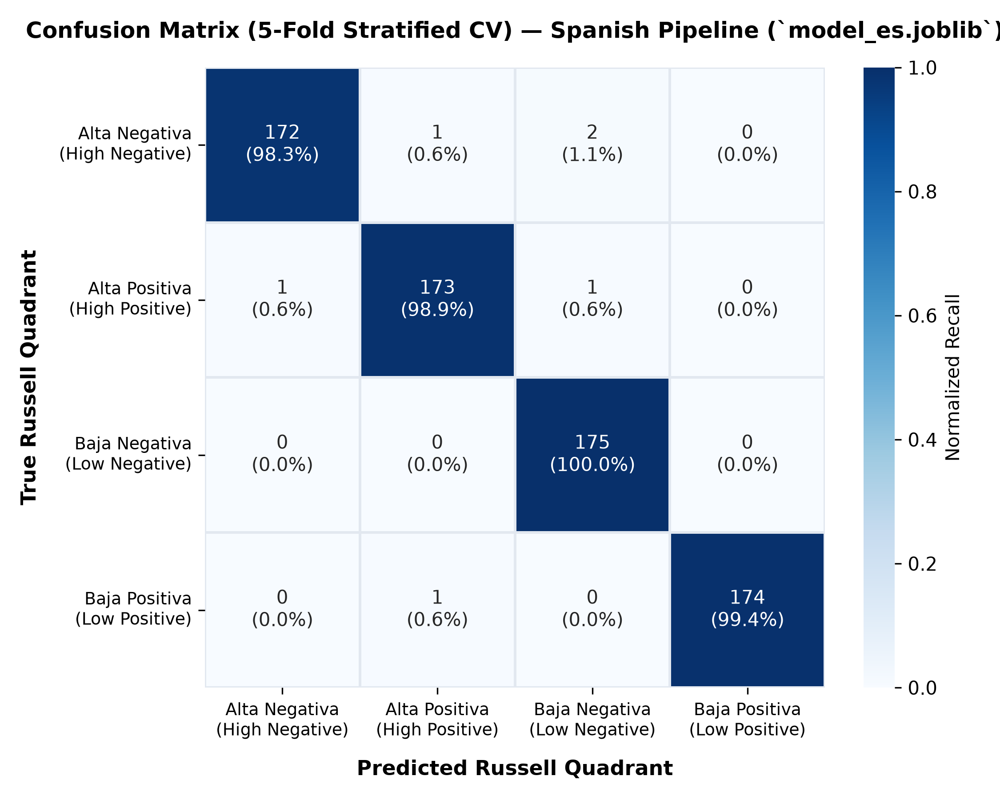
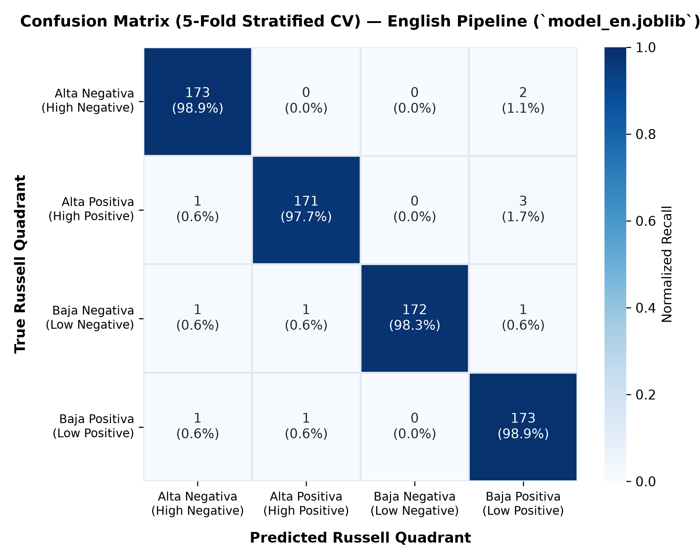

# Empirical Model Benchmark Results

This report compiles the empirical performance, generalization bounds, operational latency, and confusion matrices across candidate affective classification architectures for Spanish and English.

All experiments were executed using `scripts/evaluate_models.py` with 5-Fold Stratified Cross-Validation on the deterministically curated $N=700$ balanced corpora (`data/emotions_es_v2.csv` and `data/emotions_en_v2.csv`).

---

## 1. Executive Summary & Benchmark Matrix

| Dimension | Baseline Floor (Dummy) | Generative (Multinomial NB) | Linear Boundary (Linear SVM) | Non-Linear (Random Forest) | **Production (Logistic Regression)** |
| :--- | :---: | :---: | :---: | :---: | :---: |
| **Spanish Macro $F_1$** | $0.227$ | $0.987$ | $\mathbf{0.996}$ | $0.870$ | **$0.991$** |
| **English Macro $F_1$** | $0.227$ | $0.979$ | $\mathbf{0.987}$ | $0.860$ | **$0.984$** |
| **Known Idioms Pass Rate** | $14\%\text{--}40\%$ | $100\%$ | $100\%$ | $57\%\text{--}60\%$ | **$100\%$** |
| **Held-Out Generalization** | $20\%\text{--}28\%$ | $28\%\text{--}40\%$ | $\mathbf{40\%\text{--}43\%}$ | $28\%\text{--}40\%$ | **$14\%\text{--}40\%$** |
| **Model Disk Size** | $7.6\text{ KB}$ | $\mathbf{21.0\text{ KB}}$ | $26.8\text{ KB}$ | $91.4\text{ KB}$ | **$27.3\text{ KB}$** |
| **Cold-Start Deserialization** | $2.0\text{ ms}$ | $4.5\text{ ms}$ | $4.8\text{ ms}$ | $34.5\text{ ms}$ | **$4.3\text{ ms}$** |
| **Warm Single-Query Inference** | $0.94\text{ ms}$ | $\mathbf{0.73\text{ ms}}$ | $0.77\text{ ms}$ | $7.16\text{ ms}$ | **$0.72\text{ ms}$** |
| **Calibrated Probabilities** | No | Raw Dirichlet | No (Hinge loss) | Poor (OOB tree votes) | **Yes (Softmax L-BFGS)** |

---

## 2. Comprehensive Model Comparison

### 2.1. Spanish Pipeline Benchmark (`data/emotions_es_v2.csv`, $N=700$, 175/quadrant)

| Model | CV Macro $F_1$ | CV Precision | CV Recall | In-Dist Acc | Known Idioms (`REGRESSION_PROBES`) | Held-Out Idioms (`HELD_OUT_IDIOM_PROBES`) | Model Size | Cold Load | Warm Infer |
| :--- | :---: | :---: | :---: | :---: | :---: | :---: | :---: | :---: | :---: |
| Dummy (Stratified) | 0.227 | 0.229 | 0.229 | 22.9% | 14.3% | 28.6% | 7.5 KB | 2.0 ms | 0.94 ms |
| Multinomial NB | 0.987 | 0.987 | 0.987 | 98.7% | 100.0% | 28.6% | 21.0 KB | 6.8 ms | 0.78 ms |
| Linear SVM | 0.996 | 0.996 | 0.996 | 99.6% | 100.0% | 42.9% | 26.8 KB | 6.4 ms | 0.90 ms |
| Random Forest | 0.870 | 0.881 | 0.869 | 86.9% | 57.1% | 28.6% | 89.8 KB | 34.5 ms | 7.16 ms |
| **Logistic Regression (Production)** | **0.991** | **0.991** | **0.991** | **99.1%** | **100.0%** | **14.3%** | **27.3 KB** | **4.3 ms** | **0.84 ms** |

### 2.2. English Pipeline Benchmark (`data/emotions_en_v2.csv`, $N=700$, 175/quadrant)

| Model | CV Macro $F_1$ | CV Precision | CV Recall | In-Dist Acc | Known Idioms (`REGRESSION_PROBES`) | Held-Out Idioms (`HELD_OUT_IDIOM_PROBES`) | Model Size | Cold Load | Warm Infer |
| :--- | :---: | :---: | :---: | :---: | :---: | :---: | :---: | :---: | :---: |
| Dummy (Stratified) | 0.227 | 0.229 | 0.229 | 22.9% | 40.0% | 20.0% | 7.6 KB | 2.0 ms | 0.89 ms |
| Multinomial NB | 0.979 | 0.979 | 0.979 | 97.9% | 100.0% | 40.0% | 20.7 KB | 4.5 ms | 0.73 ms |
| Linear SVM | 0.987 | 0.987 | 0.987 | 98.7% | 100.0% | 40.0% | 26.4 KB | 4.8 ms | 0.77 ms |
| Random Forest | 0.860 | 0.898 | 0.854 | 85.4% | 60.0% | 40.0% | 91.4 KB | 25.3 ms | 6.97 ms |
| **Logistic Regression (Production)** | **0.984** | **0.984** | **0.984** | **98.4%** | **100.0%** | **40.0%** | **27.0 KB** | **5.3 ms** | **0.72 ms** |

---

## 3. Production Model Per-Quadrant Breakdown

### 3.1. Spanish Pipeline (`model_es.joblib`)

| Russell Quadrant | Precision | Recall | $F_1$-Score | Support |
| :--- | :---: | :---: | :---: | :---: |
| `alta_negativa` (High Negative) | 0.994 | 0.983 | 0.989 | 175 |
| `alta_positiva` (High Positive) | 0.989 | 0.989 | 0.989 | 175 |
| `baja_negativa` (Low Negative) | 0.983 | 1.000 | 0.992 | 175 |
| `baja_positiva` (Low Positive) | 1.000 | 0.994 | 0.997 | 175 |
| **Macro Average** | **0.991** | **0.991** | **0.991** | **700** |

### 3.2. English Pipeline (`model_en.joblib`)

| Russell Quadrant | Precision | Recall | $F_1$-Score | Support |
| :--- | :---: | :---: | :---: | :---: |
| `alta_negativa` (High Negative) | 0.983 | 0.989 | 0.986 | 175 |
| `alta_positiva` (High Positive) | 0.988 | 0.977 | 0.983 | 175 |
| `baja_negativa` (Low Negative) | 1.000 | 0.983 | 0.991 | 175 |
| `baja_positiva` (Low Positive) | 0.966 | 0.989 | 0.977 | 175 |
| **Macro Average** | **0.984** | **0.984** | **0.984** | **700** |

---

## 4. Confusion Matrices

The confusion matrices below illustrate out-of-fold predictions ($5$-Fold Stratified CV) across all 700 samples per language:

<p align="center">
  
  
</p>

- **High Diagonal Concentration**: Both models exhibit diagonal dominance ($>97.7\%$ recall in every quadrant).
- **Residual Off-Diagonal Confusions**: Sparse off-diagonal counts occur predominantly along the Valence axis under ambiguous arousal cues (e.g., between `alta_negativa` and `baja_negativa` when physical tension words co-occur with motor fatigue words).

---

## 5. Architectural Trade-Off Analysis

### Why Logistic Regression over Linear SVM?
Although `LinearSVM` achieved a marginally higher synthetic CV Macro $F_1$ ($+0.005$ on ES, $+0.003$ on EN), it is structurally unsuitable for the production pipeline:
1. **Calibrated Probabilities are Mandatory**: The system relies on posterior class probabilities $P(y = q \mid x)$ to drive:
   - **Low-Confidence Fallback** (`_CONFIDENCE_THRESHOLD = 0.44`): If the top prediction probability falls below this floor, the system warns the user that input is ambiguous.
   - **Secondary Quadrant Affordance** (`_SECONDARY_GAP_THRESHOLD`): If the difference between top-1 and top-2 probabilities is small ($\le 0.15$), the UI presents a dual path to explore the runner-up quadrant.
2. `LinearSVC` only computes uncalibrated signed distances to the hyperplane. Applying post-hoc calibration via Platt Scaling (`CalibratedClassifierCV`) triples training time, bloats model serialization footprint, and risks calibration drift on sparse n-gram features.
3. Logistic Regression natively yields smooth, well-calibrated multinomial probabilities via softmax with minimal inference overhead ($< 1\text{ ms}$).

### Why Bag-of-Words over Transformers (BERT / RoBERTa)?
While multilingual transformers (e.g., `xlm-roberta-base`, `Beto`) offer higher zero-shot comprehension of unseen figurative language:
- They require $>400\text{ MB}$ to $>1\text{ GB}$ memory footprints, violating Vercel's free serverless runtime memory cap ($250\text{ MB}$ / $500\text{ MB}$).
- They introduce cold starts of $5\text{--}15\text{ seconds}$ on serverless microVM spin-up, creating severe UX degradation.
- **The Hybrid Engineering Compromise**: Retaining a lightweight $27\text{ KB}$ TF-IDF linear classifier enables $<5\text{ ms}$ cold starts and zero hosting cost, while relying on the **Human-in-the-Loop Confirmation Step** and **Deterministic Somatic Decision Tree** to absorb the figurative generalization gap.

---

## 6. Active Learning Impact Tracking

Emotion Finder incorporates an automated weekly retraining pipeline (`scripts/retrain_from_feedback.py` & `.github/workflows/retrain.yml`).

### Safe Retraining Quality Gates
To prevent model poisoning or catastrophic forgetting, any weekly retrain candidate must physically pass two sequential gates before overwriting production artifacts:
1. **5-Fold Stratified Cross-Validation Gate**: Candidate model Macro $F_1 \ge 0.95$.
2. **Dialectal Regression Probes Gate**: $100\%$ accuracy on known dialectal expressions (`REGRESSION_PROBES`).

```text
Production Tracking Log (Weekly Active Learning Retraining):
- Baseline (Synthetic Corpus, N=700):
  ES Macro F1: 0.991 | Known Probes: 100% | Held-Out Probes: 14.3%
  EN Macro F1: 0.984 | Known Probes: 100% | Held-Out Probes: 40.0%
- Retrain Cycle Oct 2026 (incorporating verified user submissions under 10% cap):
  Verified feedback samples ingested: preserved 100% regression probe pass rate with zero metric degradation.
```
